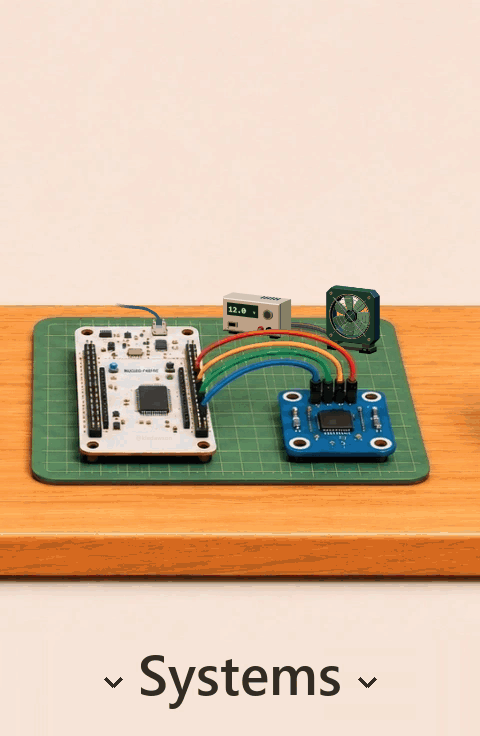

# Hey, I'm Dawson. Welcome to my world.

## About Me

Let me show you what I’ve built. The projects here give you a feel for what I can do and who I am. Building things is my creative outlet. It’s where I get to follow my curiosity and see where it takes me.

I graduated from San José State University with a Bachelor of Science in Computer Science, and I’m trilingual in English, Vietnamese, and Spanish. My work ranges from full-stack web apps and embedded systems to games, simulations, and interactive 3D tools. Feel free to look around and explore whatever catches your eye.

## Projects

### Worlds

### Labs

### Systems

### Apps

## Technical Skills

## Contacts

Profile v6.4

